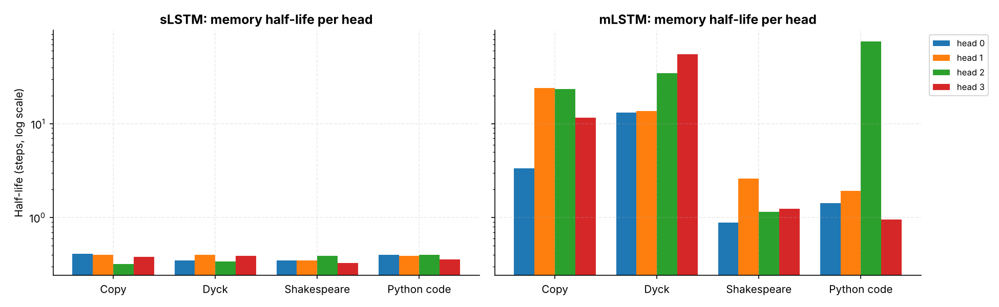

# xLSTM: Insights into Memory and Gating Dynamics

Code for my bachelor thesis at **TU Dortmund** (LS8, Department of Computer Science),
supervised by Prof. Dr. Stefan Harmeling and Marc Höftmann.

**xLSTM** ([Beck et al., 2024](https://arxiv.org/abs/2405.04517)) extends the LSTM with two new building blocks:
**sLSTM** (exponential gating, a new kind of memory mixing) and **mLSTM** (a matrix memory that can be trained in parallel).
This project implements them from scratch, compares them on several tasks, and looks inside trained models
to understand **how they store, update and read their memory**.

📄 [Thesis (PDF)](docs/thesis.pdf) · the thesis text is currently being revised

## What's inside

| Part | What it shows |
|---|---|
| [**NumPy from scratch**](numpy_implementations/) | LSTM and sLSTM with hand-derived backpropagation, verified with a gradient check |
| [**PyTorch implementations**](pytorch_implementations/) | Own LSTM, sLSTM, mLSTM and xLSTM, compared at **equal parameter budget**, plus **own mLSTM variants** |
| [**Experiments with the official models**](experiments/) | The authors' models on Copy, Dyck, Shakespeare and Python code, and **introspection** of their gates and memory |
| [**Block ordering**](experiments/block_ordering/) | Does it matter whether the sLSTM or the mLSTM block comes first? |

## Highlights

**Own extension of the mLSTM.** The original mLSTM computes its gates and memory updates from the current
input only. Two own variants also feed the previous hidden state back in. At the same number of parameters,
the per-head variant clearly improves the mLSTM:

| mLSTM (~575k parameters) | Shakespeare val loss ↓ | Dyck val accuracy ↑ |
|---|---|---|
| Original | 1.918 | 60.9% |
| **+ per-head hidden state (own)** | **1.642** | **64.6%** |

**The mLSTM adapts its memory to the task.** Measured from its forget gates, the mLSTM keeps information
for 10–55 steps on tasks that need memory (Copy, Dyck), but only 1–3 steps on Shakespeare.
The sLSTM, in contrast, overwrites its cell memory almost every step on every task.



**Block order matters.** With the same two blocks, mLSTM → sLSTM reaches 90.8% on Cycle Navigation,
while sLSTM → mLSTM collapses to 7.0%.

**Found an issue in the official library.** In the official sLSTM layer, the input and forget gate
projections are passed to the cell in swapped order ([NX-AI/xlstm#98](https://github.com/NX-AI/xlstm/issues/98)).
It does not affect training, but analyses that read the gates by name get the opposite gate.

## Verified implementations

Every implementation is checked against the math, not just trained:

- **NumPy:** hand-written gradients match numerical gradients (relative error ~1e-7)
- **PyTorch:** the stabilized mLSTM gives exactly the same output as the unstabilized formula of the paper,
  and the sLSTM heads match a block-diagonal recurrence
- **Introspection:** gate values are recorded from the library's own computation, and the mLSTM's
  retrieval weights reproduce its actual output

## Repository structure

```
numpy_implementations/     LSTM and sLSTM in NumPy, gradient check
pytorch_implementations/   LSTM, sLSTM, mLSTM (+ own variants), xLSTM in PyTorch
experiments/
├── models/                official xLSTM models (library `xlstm`)
├── training/              training with train/validation split
├── introspection/         ~40 analyses of gates, memory, keys/queries/values
├── block_ordering/        configurations for the block-ordering experiment
└── results/, figures/     results of every run and summary figures
docs/thesis.pdf
```

## Setup

```bash
pip install -r requirements.txt
```

Each part has its own README with the exact commands, settings and results.
The official models need the [`xlstm`](https://github.com/NX-AI/xlstm) library; the sLSTM runs on any machine
with its `vanilla` backend.