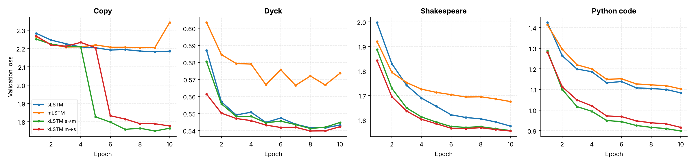
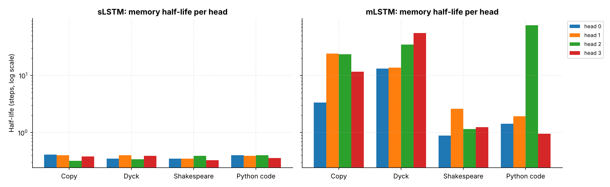
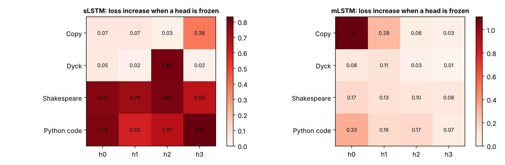
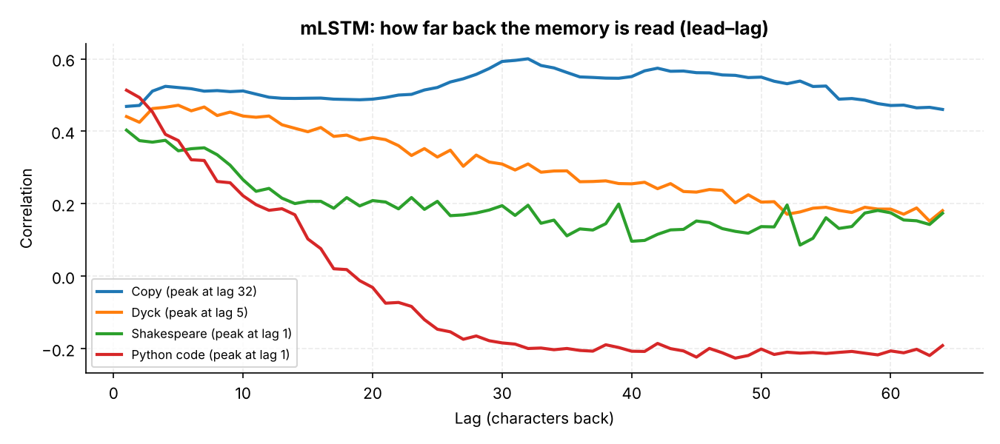

# Experiments with the official xLSTM implementation

Training and **introspection** of the authors' own models (library [`xlstm`](https://github.com/NX-AI/xlstm),
commit `ab22ead`): what do the gates and the memory of sLSTM and mLSTM actually do on different tasks?

| Folder | Content |
|---|---|
| `models/` | The four models, built with the library: sLSTM, mLSTM, xLSTM (sLSTM → mLSTM), xLSTM (mLSTM → sLSTM) |
| `training/` | Training with a train/validation split, evaluation, text generation |
| `data/` | Generators for the synthetic tasks (Copy, Dyck) and Shakespeare; Python code is downloaded automatically |
| `introspection/` | ~40 analyses of gates, matrix memory, keys/queries/values, probes and ablations |
| `results/` | One folder per run: `results.json` (settings, vocabulary, loss per epoch, final metrics) and `loss.png` |
| `figures/` | The summary figures shown below |

## Tasks

| Task | What the model must do |
|---|---|
| **Copy** | Read 32 random characters, wait through 40 `#`, then repeat the 32 characters |
| **Dyck** | Balanced brackets with nesting depth up to 5; the next bracket is forced at depth 0 and at the maximum depth |
| **Shakespeare** | Character-level language modelling |
| **Python code** | Character-level language modelling on code snippets |

## Training

Embedding 256, 4 heads, batch 64, sequence length 128, 10 epochs, AdamW (learning rate 1e-3),
gradient clipping 1.0, seed 0. Copy and Dyck have separate validation files; for Shakespeare and Python
the last 10 % of the text is the validation set.

```bash
python data/synthetic_copy.py && python data/synthetic_dyck.py
python -m training.train --model slstm --dataset copy
python -m training.train --model xlstm_sm --dataset dyck
```

The sLSTM uses the library's `vanilla` backend (plain PyTorch). The `cuda` backend computes the same thing
faster but needs Linux with the CUDA toolkit; checkpoints work with both.

### Results (validation)

| Model | Parameters* | Copy acc | Dyck acc | Shakespeare loss | Python loss |
|---|---|---|---|---|---|
| sLSTM | 0.45M | 45.9% | **67.8%** | 1.586 | 1.078 |
| mLSTM | 0.44M | 44.3% | 66.9% | 1.688 | 1.098 |
| xLSTM sLSTM → mLSTM | 0.86M | **56.8%** | 67.6% | 1.568 | **0.891** |
| xLSTM mLSTM → sLSTM | 0.86M | 56.1% | 67.7% | **1.566** | 0.909 |

\*for Copy; the size changes slightly with the vocabulary. The xLSTMs have two blocks and therefore about
twice the parameters, so this table is **not** a size-matched comparison
(see the [PyTorch models](../pytorch_implementations/README.md) for that).



- **Copy:** only the two-block xLSTMs start to copy (a sudden jump in epoch 5–6 from ~45% to ~56%).
  Predicting only the `#` padding gives ~44%, perfect copying would give ~68%.
- **Dyck:** all models end at ~67–68%. Most brackets are chosen randomly by the generator, so this is close
  to the best possible accuracy; the task does not separate the models much.
- **Text and code:** the xLSTMs are best, the mLSTM alone is weakest.

## Introspection

The analyses hook into the running model and record the **real** gate values from the library's own
computation (the stabilized gates of the sLSTM cell, and the mLSTM gates with their stabilizer), the matrix
memory `C` over time, and the mLSTM's **retrieval weights**: the mLSTM reads its memory as
`h_t = Σ_s w_ts · v_s`, where `w_ts` comes from `q_t·k_s` and the gates (not from a softmax).

```bash
cd introspection
MODEL=mlstm DATASET=dyck python run_mlstm.py          # gates of the mLSTM
MODEL=mlstm DATASET=dyck python run_mslstm_matrix.py  # matrix memory and retrieval
MODEL=mlstm DATASET=dyck python run_mslstm_kvq.py     # keys, queries, values
MODEL=slstm DATASET=dyck python run_slstm.py          # gates of the sLSTM
```

On Windows, set the variables with `$env:MODEL = "mlstm"` etc. All outputs (plots, CSVs, HTML text previews)
are written to `introspection/results/`; they are not part of the repository because of their size.

### How long does the memory last?

Half-life of the memory, from the forget gate `f = σ(f̃)`: after this many steps, old content is halved.



- **The mLSTM adapts its memory to the task.** On Copy and Dyck, its heads keep information for 10–55 steps.
  On Shakespeare all heads forget within 1–3 steps. On Python code, one head (head 2, ~76 steps)
  keeps a long memory while the others forget quickly.
- **The sLSTM's cell memory is overwritten almost every step** (half-life below one step on all tasks).
  Its longer-range information must therefore travel through the recurrent connection of the hidden state
  (`R · h`), not through the cell state. This also fits its failure on Copy.

### Which heads matter?

Loss increase when one head is frozen (input gate closed, forget gate open, so it keeps its memory
but cannot write anything new):



- **sLSTM on Dyck: one head does the job.** Freezing head 2 costs +0.80, the other heads at most +0.05.
- **mLSTM on Copy:** head 0 is essential (+1.11).
- On Shakespeare and Python, the sLSTM needs all heads to keep writing (+0.6 to +0.8 each),
  which matches its very short cell memory.

### How far back does the mLSTM read?

Correlation between the mLSTM's memory read-out and the content k characters back:



On Copy and Dyck the correlation stays high over many steps, on Shakespeare and Python it drops quickly,
consistent with the half-lives above. The peaks of the curves are weak, so they should not be over-interpreted.

## Note on the official library

In the official `sLSTMLayer`, the projections named `igate` and `fgate` are passed to the cell in the
order (fgate, igate, z, o), while the cell reads them as (i, f, z, o) (reported in
[NX-AI/xlstm#98](https://github.com/NX-AI/xlstm/issues/98), still present in commit `ab22ead`).
This does not affect training (both projections are identical in type, input and initialization),
but any analysis that reads `layer.igate` / `layer.fgate` by name gets the opposite gate.
The introspection here therefore records the gates inside the cell.

## Limitations

One run per model (seed 0), 10 epochs, no hyperparameter tuning. The introspection analyses one window of
1,000 validation characters per task.
