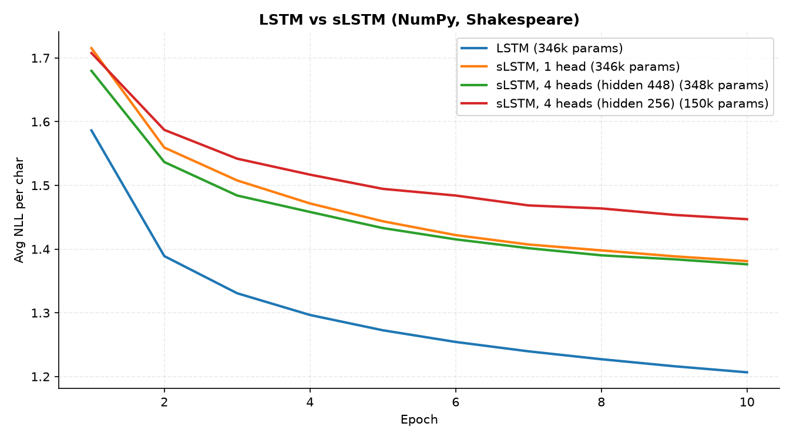

# LSTM and sLSTM from scratch in NumPy

Character-level language models implemented **without any deep learning framework**:
the forward pass, backpropagation through time (BPTT) and the parameter updates are all written by hand in NumPy.
The gradient derivations are in Chapters 1.4 (LSTM) and 3.4 (sLSTM) of the [thesis](../docs/thesis.pdf).

| File | Content |
|---|---|
| `lstm.py` | Standard LSTM: input, forget and output gates |
| `slstm.py` | sLSTM: exponential gating with stabilizer and normalizer state, multiple heads with block-diagonal recurrence |
| `train.py` | Training script for both models |
| `gradcheck.py` | Checks the hand-written gradients against numerical gradients |
| `plot_results.py` | Plots the training curves and prints the results table |

## Gradient check

The backward passes are verified with central finite differences:

```bash
python gradcheck.py
```

```
LSTM                 max relative error: 5.83e-06  PASS
sLSTM (1 heads)      max relative error: 9.38e-08  PASS
sLSTM (2 heads)      max relative error: 9.75e-07  PASS
sLSTM (4 heads)      max relative error: 1.42e-07  PASS
```

## Setup

- Data: Shakespeare text (`shakespeare.txt`, [Karpathy, 2015](https://github.com/karpathy/char-rnn)), 1.1M characters, 65 unique
- Sequence length 25 (truncated BPTT), 10 epochs
- Optimizer: Adagrad, learning rate 0.1, element-wise gradient clipping at 5
- Loss: character-level cross-entropy

## Run

```bash
cd numpy_implementations
python train.py --model lstm
python train.py --model slstm --heads 1
python train.py --model slstm --heads 4 --hidden 448
python train.py --model slstm --heads 4
python plot_results.py
```

Add `--wandb` to log to Weights & Biases (run `wandb login` once first).
For a quick test, use `--epochs 2 --max-chars 5000`.

## Results

The question: **is sLSTM better than LSTM at the same model size?**
To answer it, the sLSTM was trained with the same number of parameters as the LSTM,
once with 1 head and once with 4 heads (larger hidden size to match the size).

| Model | Hidden | Parameters | Loss ↓ | Perplexity ↓ | Bits per char ↓ |
|---|---|---|---|---|---|
| LSTM | 256 | 346k | **1.207** | **3.34** | **1.741** |
| sLSTM, 1 head | 256 | 346k | 1.381 | 3.98 | 1.993 |
| sLSTM, 4 heads | 448 | 348k | 1.376 | 3.96 | 1.985 |
| sLSTM, 4 heads | 256 | 150k | 1.447 | 4.25 | 2.088 |

*Average training loss in the last epoch.*



**Observations**

- **At equal size, the LSTM reaches a clearly lower loss** in this setup.
- **Heads do not hurt:** with the same number of parameters, 1 head and 4 heads perform almost the same.
  With 4 heads, the recurrent matrices are block-diagonal, so the model is cheaper to compute.
- **Why sLSTM does not win here:** the training uses truncated BPTT over only 25 characters,
  so long-range memory is hardly needed. This is where exponential gating, which lets the model
  revise stored information, is expected to help. The optimizer settings (Adagrad, learning rate 0.1)
  are also classic LSTM settings and were not tuned for sLSTM.

### So when does sLSTM win?

If not on short Shakespeare windows, where does exponential gating pay off?
The xLSTM paper points to **state tracking**: tasks where the model must keep and update an exact
internal state, like checking whether brackets are balanced or counting parity.
These tasks are tested in the [PyTorch models](../pytorch_implementations/README.md)
(including the Dyck bracket task) and with the authors' official implementation in the
[experiments](../experiments/), where sLSTM and mLSTM are compared on formal language tasks.

### Sample output

**LSTM**

```
GONZALO:
A pleased mean throne. A poor other croverall's
hand of unpativeNs
Ah heaven play over bele the field,
How for all majest he were a factais, undone;
This is, but he care destraches my wife.

ANTONIO:
Good fault--
More permies, Warwick! where any man o' the dread.
```

**sLSTM, 4 heads (hidden 448)**

```
PETRUCHIO:
Who is the winds?

SEBASTIAN:
Kness in my trust,
or villet, my one eare sir, and such peepting
And were it smy, my lims with fear thys duke, dreads.

ANTONIO:
Away with tell every by, lords, bego;
```

Both models learned the structure of a play (speaker names, line breaks, punctuation) from characters alone.