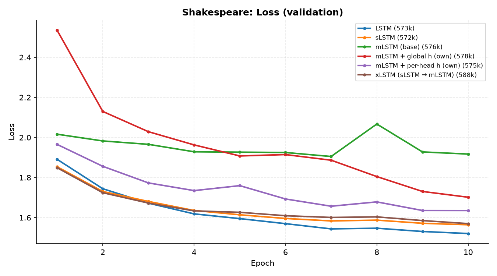
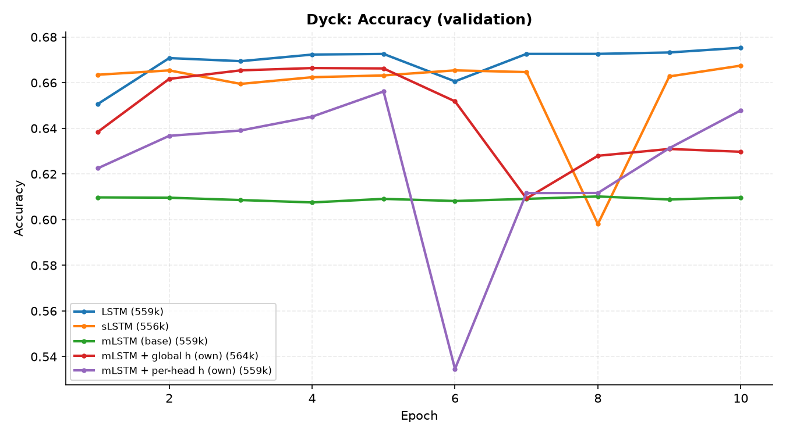

# LSTM, sLSTM, mLSTM and xLSTM in PyTorch

Own PyTorch implementations of the four recurrent models from the thesis, trained as
character-level language models. Each cell is written out step by step (no `nn.LSTM`),
so the gating and memory updates are easy to follow and to inspect.

| File | Content |
|---|---|
| `models/lstm.py` | Standard LSTM |
| `models/slstm.py` | sLSTM: exponential gating, normalizer and stabilizer state, heads with block-diagonal recurrence |
| `models/mlstm.py` | mLSTM: matrix memory per head, written with `v kᵀ` and read with the query `q` |
| `models/mlstm_global_hidden.py` | **Own variant:** mLSTM whose projections also see the full previous hidden state |
| `models/mlstm_separate_hidden.py` | **Own variant:** mLSTM whose heads each see only their own slice of the previous hidden state |
| `models/xlstm.py` | xLSTM: residual stack of sLSTM and mLSTM blocks in any order (simplified block design, see the file) |
| `train.py` | Training with a validation split; saves results, loss plot and checkpoint |
| `generate.py` | Text generation from a checkpoint |
| `size_match.py` | Finds the hidden size of each model for an equal parameter budget |
| `collect_results.py` | Builds the result tables and plots |
| `test_models.py` | Checks the models (see below) |

## Structure

```
models/      LSTM, sLSTM, mLSTM (+ 2 own variants), xLSTM
training/    data loading, training loop, checkpoints, plots, text generation
scripts/     run_all.ps1, run_sized.ps1 (all runs behind the results)
figures/     plots used in this README
runs/        results of every run (JSON + loss plot)
```

## Tests

```bash
python test_models.py
```

Checks that the sLSTM recurrence equals a block-diagonal matrix product, that the stabilized mLSTM
gives exactly the same output as the unstabilized formula from the paper, and that every model
trains with finite gradients.

## Own extension: mLSTM with hidden-state recurrence

The original mLSTM computes queries, keys, values and gates from the current input `x_t` only.
This makes it parallelizable, but it cannot use its own previous output.
Two variants add the previous hidden state `h_{t-1}` (Section 9.4 of the [thesis](../docs/thesis.pdf)):

- **Global:** every head sees `[x_t ; h_{t-1}]`, so information mixes across heads
- **Per-head:** head `i` sees `[x_t ; h_{t-1}^(i)]`, so heads stay independent

All three variants share the same memory update, so only the input to the projections differs.

## Setup

- Character-level, lower-cased text, 90 % train / 10 % validation
- **Equal parameter budget:** every model has about the same number of parameters as the LSTM with hidden size 256 (~575k).
  The hidden size of each model was chosen with `size_match.py`.
- Embedding 128, 4 heads, batch 64, sequence length 128, 10 epochs,
  Adam (learning rate 3e-3), gradient clipping at 5, seed 0
- Datasets: Shakespeare ([Karpathy, 2015](https://github.com/karpathy/char-rnn)) and
  Dyck (balanced brackets, a task that needs a stack-like memory), generated with `experiments/data/`

```bash
python train.py --model lstm
python train.py --model slstm --hidden 320
python train.py --model mlstm --mlstm_variant separate --hidden 320
python train.py --model xlstm --blocks s,m --hidden 128
python collect_results.py
```

Add `--wandb` to log to Weights & Biases.

## Results

All numbers are on the **validation set**, after 10 epochs.

### Shakespeare (~575k parameters each)

| Model | Parameters | Val loss ↓ | Val perplexity ↓ | Val accuracy ↑ |
|---|---|---|---|---|
| LSTM | 573k | **1.527** | **4.60** | **53.5%** |
| sLSTM | 572k | 1.571 | 4.81 | 52.6% |
| xLSTM (sLSTM → mLSTM) | 588k | 1.577 | 4.84 | 52.6% |
| mLSTM (base) | 576k | 1.918 | 6.81 | 42.0% |
| mLSTM + global h (own) | 578k | 1.706 | 5.51 | 48.9% |
| mLSTM + per-head h (own) | 575k | 1.642 | 5.16 | 50.6% |



### Dyck (~560k parameters each)

| Model | Parameters | Val loss ↓ | Val perplexity ↓ | Val accuracy ↑ |
|---|---|---|---|---|
| LSTM | 559k | **0.547** | **1.73** | **67.4%** |
| sLSTM | 556k | 0.583 | 1.79 | 66.6% |
| mLSTM (base) | 559k | 0.699 | 2.01 | 60.9% |
| mLSTM + global h (own) | 564k | 0.676 | 1.97 | 62.8% |
| mLSTM + per-head h (own) | 559k | 0.647 | 1.91 | 64.6% |



### Observations

- **At equal size, the LSTM is best on both tasks** in this setup. sLSTM and xLSTM follow closely.
  A 4× larger xLSTM (2.3M parameters, hidden 256) reaches almost the same result (val loss 1.579),
  so more parameters alone do not close the gap.
- **sLSTM vs. mLSTM on Dyck:** the base mLSTM does not learn the bracket structure at all
  (its accuracy stays flat at ~61%), while the sLSTM reaches 66.6%. This matches the xLSTM paper:
  sLSTM can track a state, the parallelizable mLSTM cannot.
- **The own mLSTM variants clearly improve the mLSTM.** At the same size, the per-head variant lowers
  the Shakespeare loss from 1.918 to 1.642 and raises Dyck accuracy from 60.9% to 64.6%.
  Giving the base mLSTM more parameters did not help it (1.880 → 1.918 on Shakespeare),
  so the improvement comes from the hidden-state recurrence, not from size.
- **The global variant is still improving at epoch 10** on Shakespeare, so longer training could change the order.
- **Instabilities:** the mLSTM variants and the sLSTM show sudden drops on Dyck
  (e.g. per-head in epoch 6) and recover afterwards. The learning rate of 3e-3 was not tuned per model.

### Copy task

On the Copy task (32 random characters, a gap of 40 `#`, then the same characters again),
none of the mLSTM variants learned to copy. All reach ~44% accuracy, which is what you get by only
predicting the `#` padding; real copying would give ~68%.

| mLSTM, hidden 256 | Val loss | Val accuracy |
|---|---|---|
| base | 2.242 | 45.5% |
| global h | 2.302 | 44.3% |
| per-head h | 2.276 | 44.4% |

## Limitations

One run per model (seed 0), 10 epochs, and the same learning rate for all models.
Small differences, such as between sLSTM and xLSTM on Shakespeare, are within run-to-run noise.
The xLSTM blocks are simplified compared to the paper (see `models/xlstm.py`).
Results with the authors' official implementation are in [experiments](../experiments/).